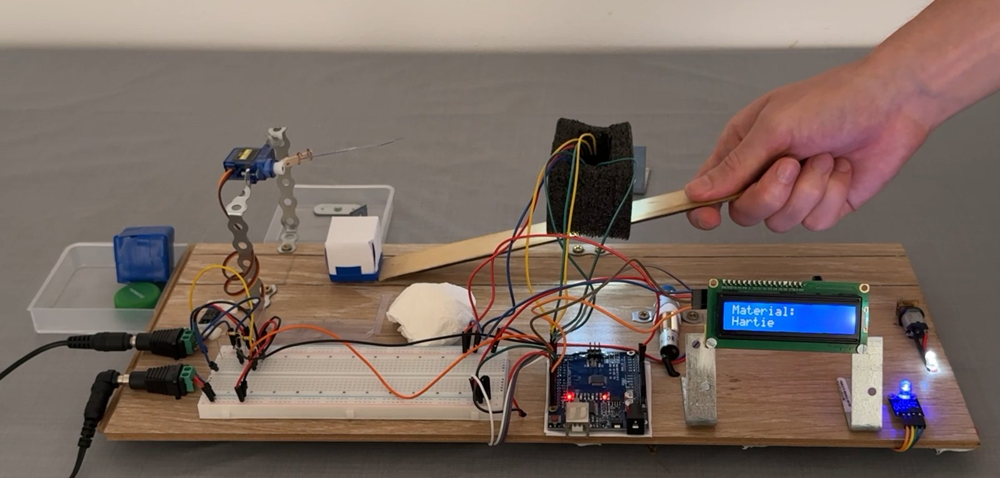
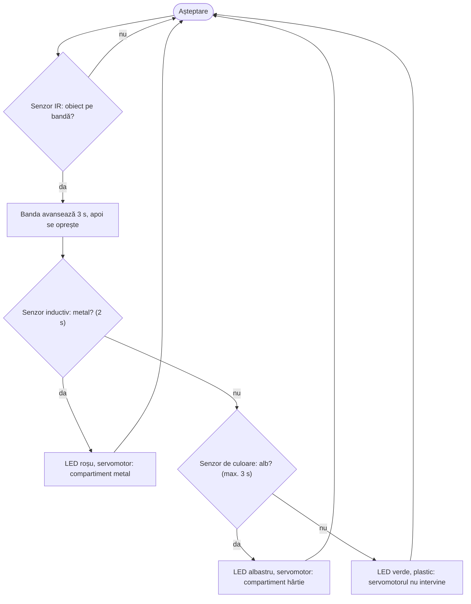
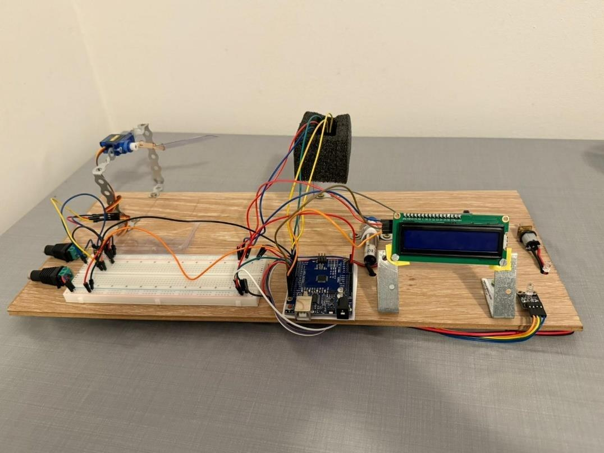

# Sistem automat de sortare a deșeurilor (Arduino)

Prototip care recunoaște automat trei tipuri de deșeuri (**metal, hârtie, plastic**) și le sortează cu un servomotor. Este construit pe Arduino UNO, cu trei senzori diferiți pentru detecție și cu un ecran LCD care arată ce material a fost recunoscut.



**Demonstrație video:** [link YouTube - de adăugat]

## Ce face

- detectează când un obiect este pus pe bandă (senzor IR)
- verifică dacă obiectul este **metalic** (senzor inductiv)
- dacă nu este metal, verifică dacă este **alb**, deci hârtie (senzor de culoare TCS3200)
- orice alt obiect nemetalic este considerat **plastic**
- arată rezultatul pe un LCD 16x2 și pe un LED RGB (roșu = metal, albastru = hârtie, verde = plastic)
- servomotorul direcționează obiectul în compartimentul potrivit
- dacă timp de 25 de secunde nu mai apare niciun obiect, banda se oprește singură

## Cum funcționează



Senzorul de culoare funcționează prin filtre pentru roșu, verde și albastru. Pentru fiecare canal, programul măsoară durata semnalului de ieșire (`pulseIn`), iar valorile sub un anumit prag înseamnă multă lumină reflectată. Dacă toate trei canalele sunt sub prag, obiectul este considerat alb.

## Componente

| Componentă | Rol |
|---|---|
| Arduino UNO R3 | unitatea de control |
| Senzor IR TCRT5000 | detectează prezența obiectului |
| Senzor inductiv LJ12A3-4-Z/BY | detectează metalul |
| Senzor de culoare TCS3200 | deosebește hârtia (alb) de plastic |
| Servomotor SG90 (180°) | împinge obiectul în compartiment |
| Motor DC cu reductor | acționează banda |
| LCD 16x2 cu adaptor I2C | afișează starea și materialul |
| LED RGB | indică materialul detectat |
| Panou din lemn, breadboard, cabluri | structura de montaj |

Alimentarea se face de la un adaptor de 9 V / 1 A.

## Conexiuni (pini Arduino)

| Pin | Componentă | Observație |
|---|---|---|
| D2 | TCS3200 `OUT` | semnal de frecvență |
| D3, D4 | TCS3200 `S2`, `S3` | alegerea filtrului de culoare |
| D5, D6 | TCS3200 `S0`, `S1` | frecvența de ieșire (setată la 20%) |
| D7 | senzor IR (TCRT5000) | `LOW` = obiect detectat |
| D8 | senzor inductiv | `HIGH` = metal detectat |
| D9 | servomotor SG90 | semnal PWM |
| D10, D11, D12 | LED RGB (roșu, verde, albastru) | catod comun |
| D13 | motorul benzii | pornit / oprit |
| A4, A5 | LCD I2C (`SDA`, `SCL`) | adresa 0x27 |



## Cum se încarcă programul

1. Instalează [Arduino IDE](https://www.arduino.cc/en/software).
2. Instalează din **Library Manager** biblioteca **LiquidCrystal I2C**. Bibliotecile `Servo` și `Wire` vin cu Arduino IDE.
3. Deschide `cod/sortare_deseuri/sortare_deseuri.ino`.
4. Alege placa **Arduino UNO** și portul corect (**Tools**), apoi apasă **Upload**.
5. Pentru a vedea valorile citite de senzorul de culoare, decomentează liniile cu `Serial.print` din funcția `detecteazaCuloare()` și deschide Serial Monitor la 9600 baud.

Pragurile de culoare (`PRAG_NEGRU`, `PRAG_ALB`) și timpii din program sunt reglați pentru montajul meu. La un alt montaj sau alt tip de iluminare trebuie ajustați.

## Testare

Am testat prototipul cu obiecte reprezentative: un capac PET (plastic), un șurub și folie de aluminiu (metal) și bucăți de hârtie.

- senzorul inductiv se activează cel mai bine când metalul este la aproximativ 1 cm de el
- senzorul de culoare dă uneori valori greșite din cauza reflexiilor, mai ales la hârtia lucioasă sau mototolită
- fiecare senzor a fost verificat separat în Serial Monitor înainte de a fi integrat în programul complet

## Limitări

- **hârtia este recunoscută doar dacă e albă**, iar orice obiect nemetalic care nu este alb ajunge la categoria „plastic"
- sistemul depinde de iluminarea din jur, deoarece senzorul de culoare nu are calibrare automată
- timpii de avans ai benzii sunt fixi și funcția `delay()` blochează programul, așa că sistemul nu poate face altceva cât timp așteaptă

## Idei de îmbunătățire

- înlocuirea senzorului TCS3200 cu un TCS34725, care are filtru infraroșu și citire digitală
- calibrare a senzorului de culoare, cu valori salvate în EEPROM
- înlocuirea `delay()` cu `millis()` și organizarea programului ca o mașină de stări
- un al doilea senzor de proximitate, în locul timpilor fixi, pentru a ști exact când obiectul ajunge la servomotor
- o cameră (de exemplu ESP32-CAM) pentru recunoașterea mai multor tipuri de materiale

## Structura proiectului

```
├── README.md
├── cod/
│   └── sortare_deseuri/
│       └── sortare_deseuri.ino
└── docs/
    ├── prototip.jpg
    └── montaj.jpg
```

## Resurse folosite

- Documentația oficială Arduino și bibliotecile `Servo`, `Wire`, `LiquidCrystal_I2C`
- Tutorialul Last Minute Engineers pentru interfațarea senzorului TCS3200 cu Arduino
- Tutorialul Electropeak pentru senzorul inductiv LJ12A3-4-Z/BY
